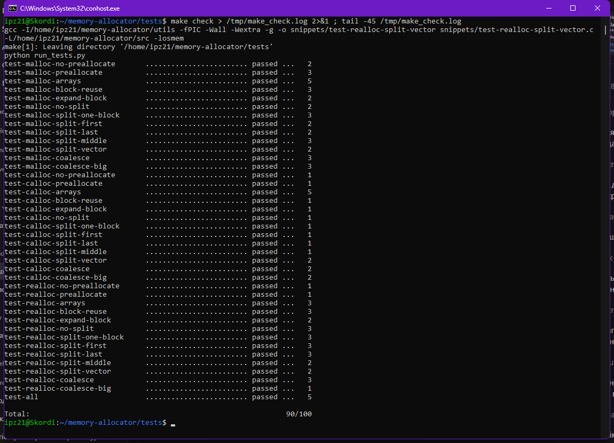

# Memory Allocator

Власна реалізація `malloc()`, `calloc()`, `realloc()` і `free()` мовою C
за завданням курсу [Operating Systems (open-education-hub)](https://github.com/open-education-hub/operating-systems/tree/main/content/assignments/memory-allocator).
Оригінальна умова лежить у [ASSIGNMENT.md](ASSIGNMENT.md).

Рішення: [src/osmem.c](src/osmem.c).

## Результат

Офіційний чекер (`make check`, з перевіркою витоків через valgrind):
усі 40 тестів пройдено, **90/100** (максимум для автоматичної перевірки).



Усі скріншоти зроблені на моїй машині (Ubuntu 24.04 у WSL2) і лежать у [screenshots/](screenshots/):

| Файл | Що на ньому |
|------|-------------|
| `01-environment.png` | версії ОС, gcc, valgrind, ltrace, python |
| `02-build.png` | збірка `libosmem.so` у `src/` |
| `03-make-check.png` | результат `make check`: 40/40 тестів, 90/100 |
| `04-memcheck.png` | окремий тест `test-all` з перевіркою витоків |
| `05-git.png` | структура репозиторію |

## Як реалізовано

- **Метадані.** Кожен блок починається зі `struct block_meta` (32 байти після
  вирівнювання), за нею йде payload. Повертається адреса payload.
- **Вирівнювання.** Усі розміри й адреси вирівняні до 8 байтів.
- **brk чи mmap.** `os_malloc` / `os_realloc` беруть пам'ять через `mmap()`,
  якщо блок разом із метаданими ≥ `MMAP_THRESHOLD` (128 КБ); `os_calloc` —
  якщо ≥ розміру сторінки. Менші блоки йдуть на heap через `sbrk()`.
- **Преалокація heap.** При першому зверненні до heap виділяється 128 КБ
  одним викликом `brk()`, далі цей блок розбивається.
- **Find best.** Перед пошуком сусідні вільні блоки зливаються (coalesce),
  потім вибирається найменший вільний блок, у який влазить запит.
- **Split.** Залишок блоку стає новим вільним блоком, якщо в нього влазять
  метадані й хоча б 8 байтів payload.
- **Розширення останнього блоку.** Якщо підходящого блоку немає, а останній
  блок heap вільний, він розширюється через `sbrk()` на потрібну різницю.
- **os_free.** Блок на heap лише позначається вільним (пам'ять не
  повертається ОС); mmap-блок звільняється через `munmap()`.
- **os_realloc.** Зменшення — split на місці. Збільшення: останній блок
  розширюється через `sbrk()`; інакше наступні вільні блоки поглинаються по
  одному з перевіркою розміру після кожного; якщо не вистачило — новий блок,
  `memcpy`, звільнення старого. mmap-блоки завжди переносяться. Для вже
  звільненого блоку повертається `NULL`.
- Помилка кожного системного виклику перевіряється макросом `DIE()`.

## Запуск

```bash
sudo apt install build-essential ltrace valgrind python-is-python3
cd tests
make check
```
